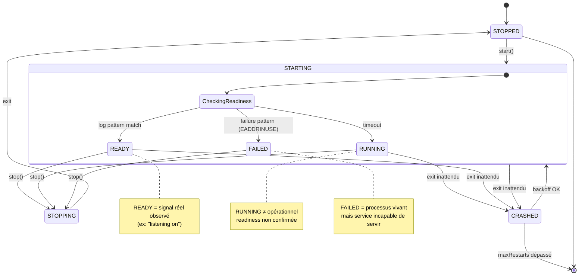
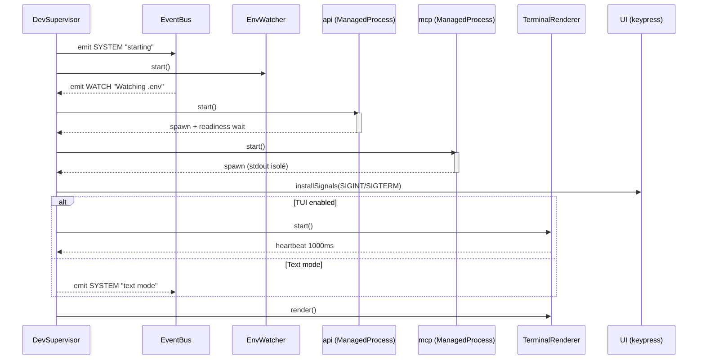
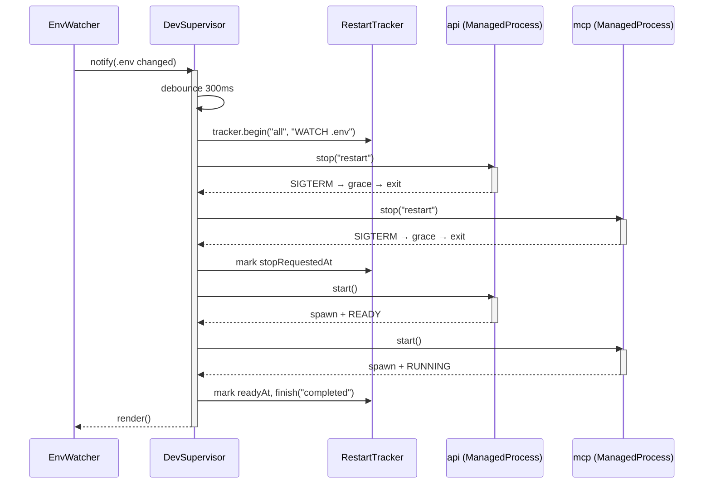
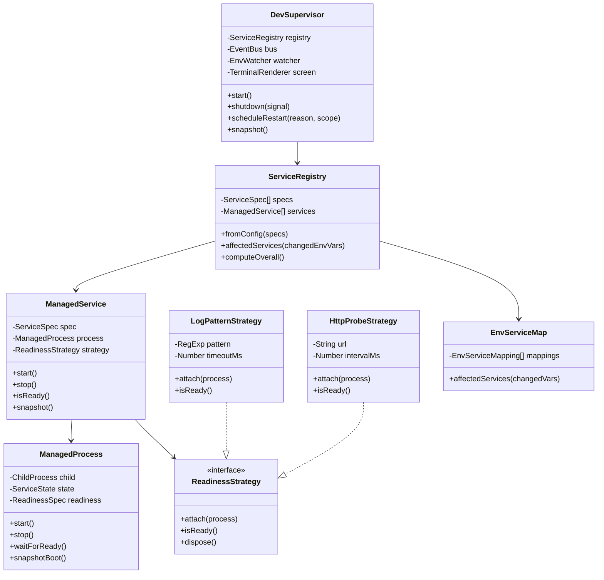
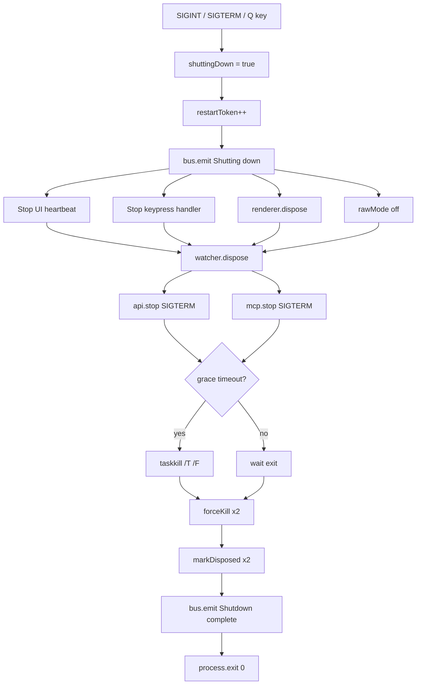
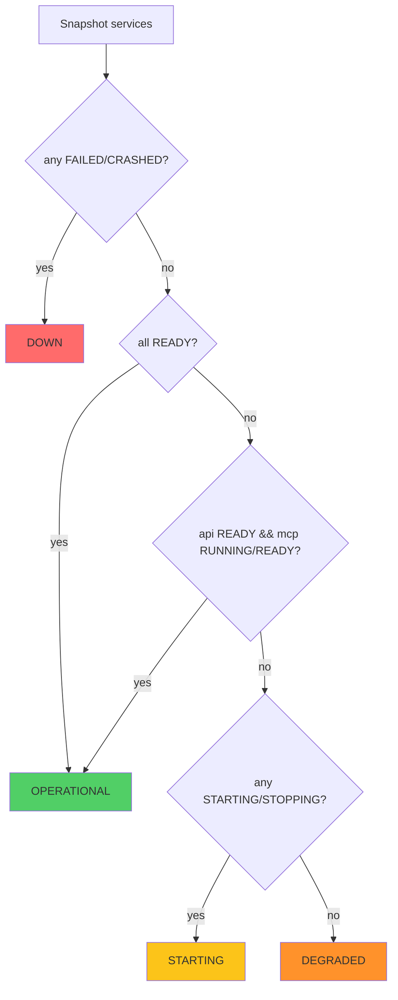
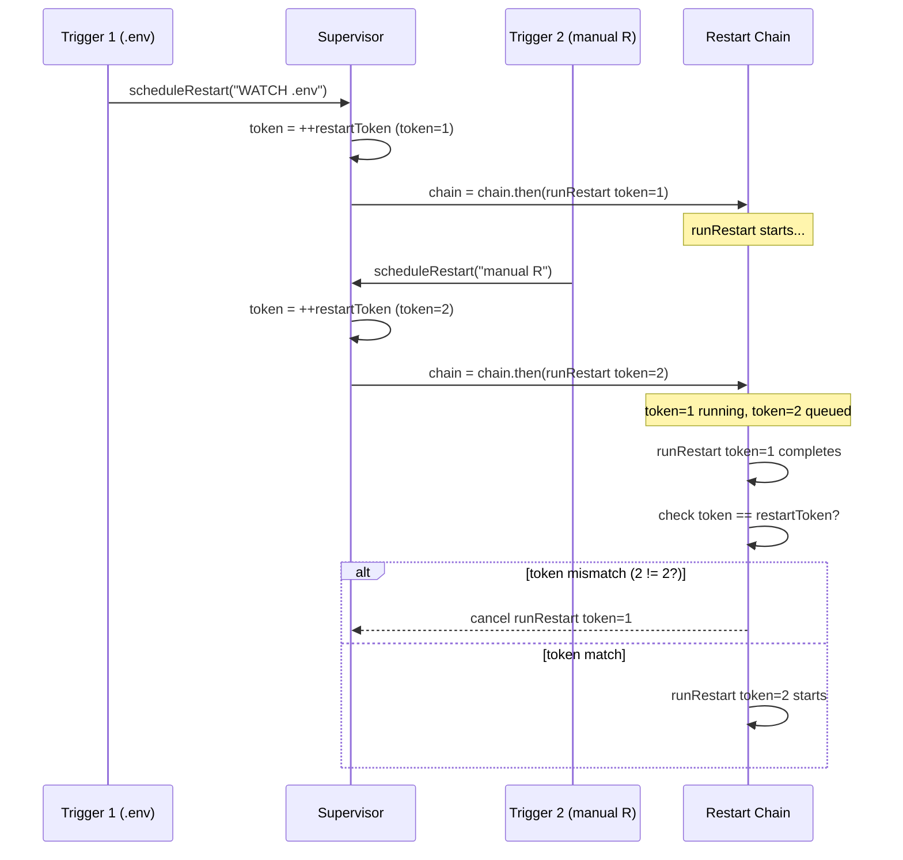
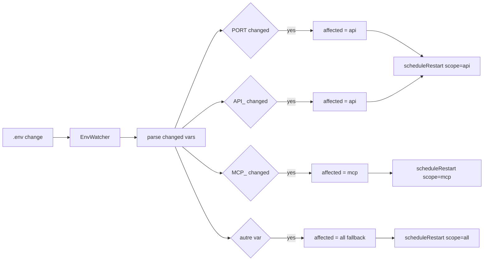

# Diagrammes — Dev Server Lifecycle

> Date : 2026-10-31
> Outil : Mermaid (compatible GitHub, VSCode, Notion)

---

## 1. Cycle de vie ManagedProcess (état actuel)



---

## 2. Séquence de démarrage (DevSupervisor)



---

## 3. Restart déclenché par .env change



---

## 4. Architecture CIBLE (avec ManagedService)



---

## 5. Shutdown graceful



---

## 6. Calcul état global (computeOverall)



---

## 7. Restart serialization (mutex + token)



---

## 8. Arbre de décision readiness

```mermaid
graph TD
    A[Process spawned] --> B{readiness pattern?}
    
    B -->|no MCP| C[ state = RUNNING ]
    C --> D[ readiness = "unknown (no probe)" ]
    
    B -->|yes API| E{log chunk}
    
    E --> F{failure pattern?}
    F -->|yes EADDRINUSE| G[ state = FAILED ]
    G --> H[ readiness = "startup failed" ]
    
    F -->|no| I{readiness pattern?}
    I -->|yes| J[ state = READY ]
    J --> K[ readiness = "confirmed" ]
    
    I -->|no| L{timeout?}
    L -->|yes| M[ state = RUNNING ]
    M --> N[ readiness = "awaiting log signal" ]
    L -->|no| E
```

---

## 9. Mapping env → service (futur)


